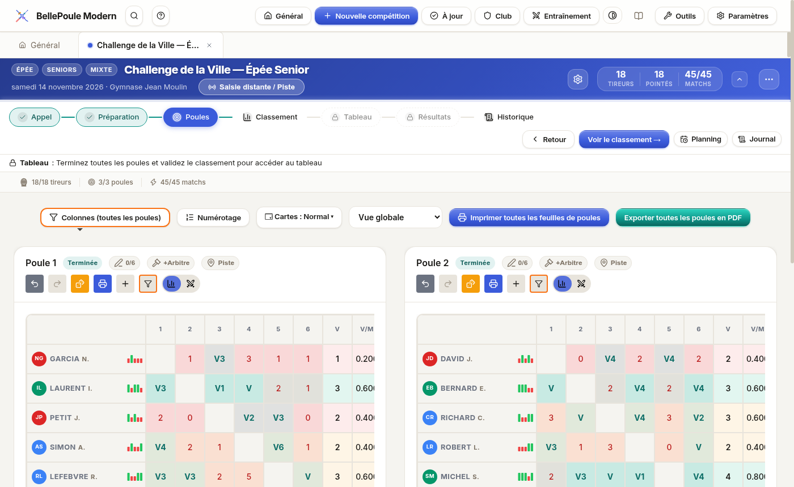
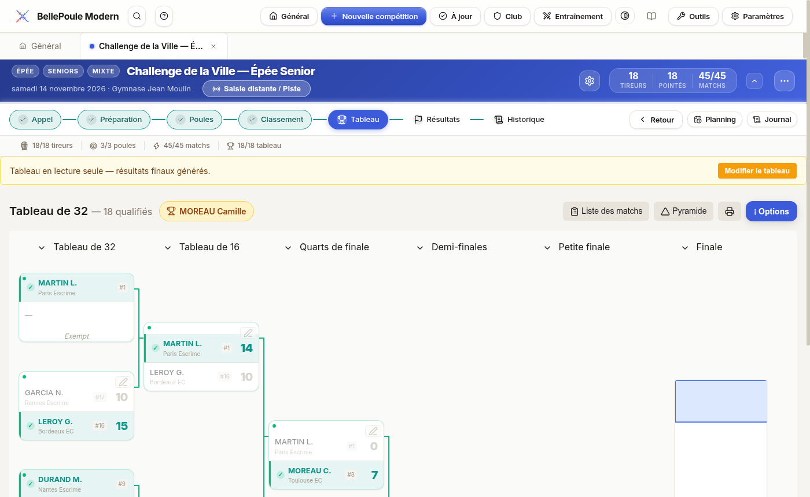
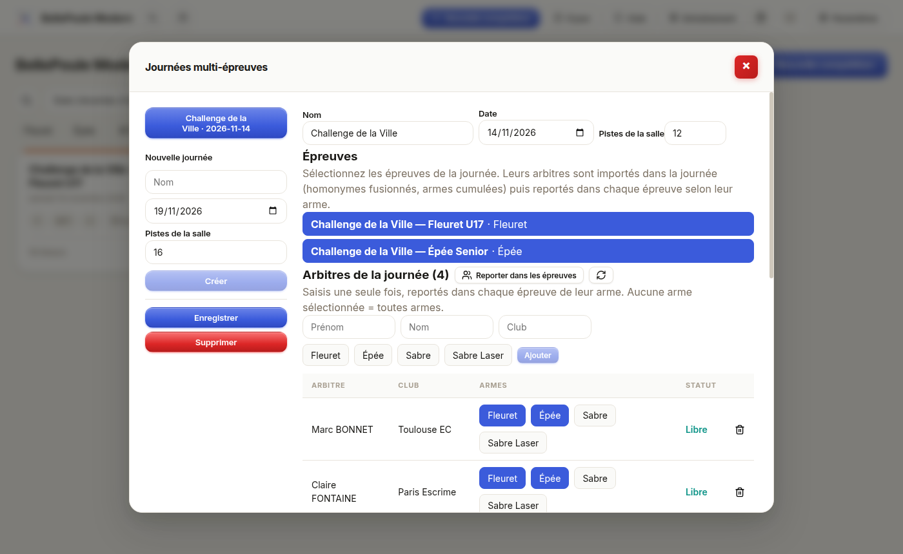
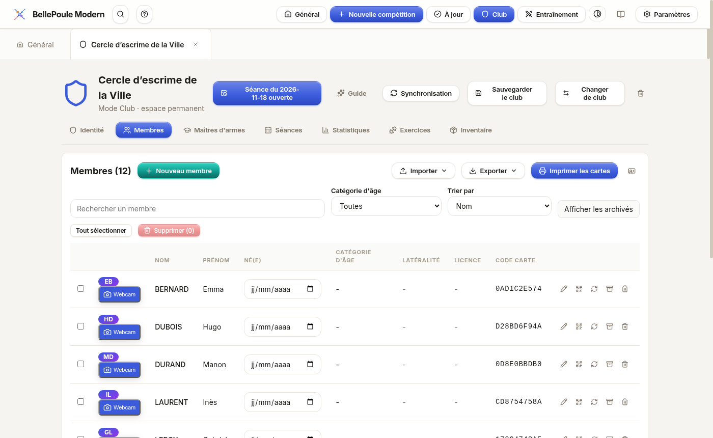

# BellePoule Modern - Logiciel moderne de gestion de compétitions d'escrime

🤺 **Logiciel moderne de gestion de compétitions d'escrime** avec interface multilingue et temps réel

---

☕ **Ce projet est gratuit et open source.** Si BellePoule Modern vous est utile, vous pouvez soutenir son développement :

**[👉 Buy Me a Coffee — klinnex](https://buymeacoffee.com/klinnex)**

Merci pour votre soutien ! / Thank you for your support!

---

### 📚 **Documentation**

| Public | Document |
|---|---|
| Aperçu | **[Captures d'écran des menus](docs/SCREENSHOTS.md)** |
| Organisateur | [Manuel utilisateur](USER_MANUAL.md) · [Installation](INSTALLATION.md) · [Saisie distante](REMOTE_SCORE_GUIDE.md) · [Démarrage express](REMOTE_SCORE_GUIDE.md#démarrage-express) · **[Journée multi-épreuves](docs/JOURNEE_MULTI_EPREUVES.md)** |
| Arbitre | **[Interface d'arbitrage](docs/ARBITRAGE.md)** · **[Scénarios de match](docs/SCENARIOS_MATCH.md)** · **[Appareils de piste Cyrano](docs/CYRANO.md)** · **[OPP2 / MQTT](docs/OPP2.md)** |
| Club | **[Mode Club](docs/MODE_CLUB.md)** |
| Équipes | [Compétitions par équipes](docs/TEAM_COMPETITIONS.md) · [Sabre Laser](docs/PROCEDURE_SABRE_LASER.md) |
| Exports | [Guide export PDF](docs/USER_GUIDE_PDF_EXPORT.md) · [Formats de fichiers](FILE_FORMATS.md) |
| Données | **[RGPD et données personnelles](docs/RGPD.md)** · **[Agent IA (MCP)](docs/MCP.md)** |
| Développeur | [Architecture](ARCHITECTURE.md) · **[Stack technique et versions](docs/STACK_TECHNIQUE.md)** · [Guide de développement](DEVELOPMENT_GUIDE.md) · [Versionnage](docs/VERSIONING.md) · [Contribuer](CONTRIBUTING.md) |
| Divers | [Dépannage](TROUBLESHOOTING.md) · [Mises à jour](UPDATE_SYSTEM.md) · **[Commandes Ctrl+K](docs/COMMANDES.md)** · [Sécurité saisie distante](docs/SECURITE_SAISIE_DISTANTE.md) · [Politique de sécurité](SECURITY.md) · [Index complet](docs/README.md) |

### 📸 **Captures d'écran**

| Poules | Tableau |
|---|---|
| [](docs/SCREENSHOTS.md#poules) | [](docs/SCREENSHOTS.md#tableau) |
| **Journée multi-épreuves** | **Mode Club** |
| [](docs/SCREENSHOTS.md#journée-multi-épreuves) | [](docs/SCREENSHOTS.md#mode-club--membres) |

Tous les écrans : **[docs/SCREENSHOTS.md](docs/SCREENSHOTS.md)**.

### 🔧 **Installation**

- **Windows** : installeur NSIS ou exécutable portable (x64)
- **macOS** : DMG ou ZIP (Intel x64 et Apple Silicon arm64)
- **Linux** : AppImage, .deb ou .rpm (x64) ; AppImage ou .deb (arm64, Raspberry Pi…) ; paquet Nix ([INSTALLATION.md](INSTALLATION.md#nix-flake))

### 🚀 [**Télécharger la dernière version stable**](https://github.com/BellePoule-Modern/bellepoule-modern/releases/latest)

### 🧪 [**Télécharger la version de développement (dev)**](https://github.com/BellePoule-Modern/bellepoule-modern/releases?q=-dev.&expanded=true)

> ⚠️ **Version de test** : Contient les dernières fonctionnalités mais peut être instable

## 🆕 Nouveautés de la version 2.0

> ⚠️ **Version majeure.** Au premier lancement, la base locale est **chiffrée** (SQLCipher) et
> migrée vers le nouveau schéma : elle ne pourra plus être ouverte par une version 1.x.
> Exportez vos compétitions (`.bpm`) avant la mise à jour si vous devez revenir en arrière.

### 🏟️ **Journée multi-épreuves**

- Plusieurs épreuves d'une même salle regroupées dans une **journée**
- **Arbitres saisis une fois**, reportés dans chaque épreuve selon leur arme, conflits signalés
- **Pistes partagées** : pistes libérées proposées aux épreuves en attente, réservation par piste, kiosque de la journée
- **Salles et pistes** enregistrées dans les paramètres, plan des pistes, pistes indisponibles

Voir [docs/JOURNEE_MULTI_EPREUVES.md](docs/JOURNEE_MULTI_EPREUVES.md).

### 📟 **Appareils de piste Cyrano**

- Protocole **Cyrano EFP1 / EFP1.1** (UDP) : appareils raccordés aux arènes, score et chrono remontés de l'appareil
- Pistes ajoutées en lot, mode maître / esclave, journal des trames, supervision
- Relais par équipes (FIE) piloté depuis l'appareil de piste
- Simulateur et télécommande web pour tester sans matériel (`npm run cyrano:sim`, `npm run cyrano:remote`)

Voir [docs/CYRANO.md](docs/CYRANO.md).

### 🛡️ **Mode Club**

- Espace permanent du club : **membres** (carte à code, photo webcam, import / export), **maîtres d'armes**
- **Séances** préparées ou libres : scan des cartes, pointage, plan de cours, exercices, combats libres sur tablette
- **Statistiques** par période et catégorie d'âge, **inventaire** du matériel et prêts
- Sauvegarde `.bpclub` et synchronisation entre postes

Voir [docs/MODE_CLUB.md](docs/MODE_CLUB.md).

### 🔐 **RGPD et sécurité des données**

- **Base chiffrée au repos** (SQLCipher, clé dans le trousseau du système)
- Recherche d'une personne, **export** JSON / PDF, **anonymisation**, **effacement**
- Durée de conservation, noms masqués sur le réseau, archives `.bpm` **chiffrées par mot de passe**

Voir [docs/RGPD.md](docs/RGPD.md).

### 🤖 **Agent IA (MCP)**

- Serveur **MCP** intégré, désactivé par défaut, sur `127.0.0.1` avec jeton
- Lecture de l'état d'une journée ou d'une salle (retards, pistes libres, arbitres, tablettes) ; écriture sur autorisation (pointage, poules, scores, imports)
- Mode `--headless` et import par manifeste (`--batch-import`), plugin Claude Code fourni

Voir [docs/MCP.md](docs/MCP.md).

### ✨ **Et aussi**

- ⌨️ **Navigation clavier** : palette `Ctrl+K`, phases `Ctrl+1…8` / `Ctrl+←→`, `Ctrl+Z` pour annuler la dernière action ([liste](docs/COMMANDES.md))
- 🧭 **Parcours guidé**, infobulles accessibles, densité d'affichage réglable, logo et icônes refaits
- 🏠 **Accueil** : compétitions récentes et épinglées, filtres arme / sexe / catégorie, recherche
- 🎯 **Poules** : saisie simplifiée (`V`, `W`+chiffre), ordre officiel des matchs, échanges au plus proche classement, impression de toutes les feuilles en une fois
- 📱 **Tablettes** : dixièmes de seconde, match précédent, pause sabre à 8 touches, badge de synchronisation, ergonomie tactile
- 🟥 **Carton noir** : rang « - » et décalage des suivants, rapport FFE d'exclusion pré-rempli, DNF / DNS pour les forfaits en poules
- 📊 **Analytics** : KPI des armes olympiques, onglets Organisation / Arbitres / Journal, rapport PDF post-tournoi
- 📄 **PDF** : dossier de compétition (sections et ordre au choix), cartons sur la feuille de poule, export de toutes les poules en un fichier
- 🎨 **Thèmes** d'écrans prédéfinis (Steampunk, Mousquetaires, Arcade 8-bit, Sumi-e, Licorne…)
- 🗡️ **Tournoi des rapières** et format arène **Sabre Laser équipe** (ASL-FFE)
- 🌍 Trois nouvelles langues : **italien**, **portugais**, **russe**

### 🔮 **Fonctionnalités à venir**

Chantiers ouverts ([issues GitHub](https://github.com/BellePoule-Modern/bellepoule-modern/issues)) :

- 🖧 **Moteur headless multi-postes** : comptes et rôles, plusieurs écrans sur la même épreuve
- 📐 **Formules FFE / FIE** étendues : tirages, tableaux préparés avant la fin des poules
- 🗓️ **Planning prévisionnel** de la journée (Gantt des pistes) et durées de match de référence
- 👨‍⚖️ **Affectation automatique des arbitres** : répartition optimale (couplage de coût minimal), neutralité club / nationalité / ligue, diagnostic des manques
- 📤 **Export XML FIE 3.3** complet et publication des résultats sur **GREG** (escrime-info.com)
- 📡 Pilote d'appareils **OPP2** (JSON sur MQTT), à côté de Cyrano

[Voir ROADMAP.md](./ROADMAP.md)

## 🌐 Langues disponibles

- 🇫🇷 **Français** (par défaut)
- 🇬🇧 **Anglais**
- 🇫🇷 **Brezhoneg (Breton)**
- 🇪🇸 **Català (Catalan)**
- 🇩🇪 **Deutsch (Allemand)**
- 🇪🇸 **Español (Espagnol)**
- 🇵🇹 **Português (Portugais)** _(Nouveau !)_
- 🇮🇹 **Italiano (Italien)** _(Nouveau !)_
- 🇷🇺 **Русский (Russe)** _(Nouveau !)_
- 🇭🇰 **繁體中文 (Chinois traditionnel – Hong Kong)**

## 🎯 Caractéristiques principales

- **🗂️ Base de données SQLite chiffrée** (SQLCipher) pour toutes les données de compétition et de club
- **🌐 Interface moderne** avec design épuré et responsive
- **📱 Gestion en temps réel** des scores et arènes, tablettes et appareils de piste Cyrano
- **🏟️ Journées multi-épreuves** avec pistes et arbitres partagés
- **🛡️ Mode Club** : membres, séances, statistiques, inventaire
- **🏊 Support multilingue** (français, anglais, breton, catalan, allemand, espagnol, portugais, italien, russe, chinois traditionnel HK)
- **👨‍⚖️ Gestion des arbitres** avec assignation automatique et rotation
- **🔔 Webhooks** Discord/Slack
- **🖥️ Tableau de bord Live** et **Mode Kiosk** pour affichage public
- **📱 Mode déconnecté** pour les tablettes arbitres
- **⚡️ Sauvegarde automatique** des données
- **📊 Export des résultats** en multiple formats
- **🤖 Agent IA (MCP)** local, désactivé par défaut
- **🔐 Sécurité et RGPD** : chiffrement, export, anonymisation, effacement

## 🎯 Fonctionnalités principales

### 📋 **Appel (pointage)**

- ✅ Inscription et gestion des tireurs (nationalité, département, latéralité)
- ✅ Import FFE / XML / CSV / Excel, modèle d'import téléchargeable
- ✅ Pointage/dépointage
- ✅ Support abandon et forfait avec impact automatique sur tous les matchs
- ✅ Mise à jour automatique des classements

### 🎯 **Poules**

- ✅ Génération automatique des poules serpentine, critères de séparation (club, région, nation)
- ✅ Configuration personnalisée (nombre de tireurs par poule, tours de poules)
- ✅ Saisie rapide (souris, clavier simplifié), annulation / rétablissement
- ✅ Système de chronométrage des matchs
- ✅ Support des défections (abandon, forfait, exclusion)
- 📄 **Intégration PDF** - Feuilles de poule avec piste, cartons et signatures

### 🏆 **Tableau et résultats**

- ✅ Élimination directe, petite finale, vues tableau / pyramide
- ✅ Podium et classement final, exports XML FFE / CSV / PDF
- ✅ Historique horodaté de chaque modification de score

### 📄 **Export PDF**

- 📋 **Format professionnel** - Cadre "PISTE X" et matchs en colonnes, A4 paysage
- 🎯 **Export simple et multiple** - Une poule ou toutes les poules dans un seul document
- 📚 **Dossier de compétition** - Sections et ordre au choix (individuel et équipes)
- 🔧 **Options avancées** - Filtrage des matchs, classements, modèles personnalisables

### 📊 **Tableau de bord analytique**

- 📈 **Métriques en temps réel** - Avancement des poules, durée moyenne des matchs
- 🏆 **Meilleurs tireurs** - Classement des tireurs les plus performants
- 🎯 **Statistiques par arme** - KPI des armes olympiques, zones de touches (Sabre Laser)
- 🕒 **Organisation** - Poules en retard, écart au planning, arbitres
- 📄 **Rapport PDF** post-tournoi

### 📱 **Interface tablette**

- 🎯 **Optimisation tactile** - Grandes zones de touche, retour à l'appui
- 🔊 **Minuteur vocal** - Annonces du temps restant sur la tablette d'arbitrage (TTS)
- ⏱️ **Grand chronomètre** - Visible de loin, dixièmes de seconde
- 🔄 **Actions rapides** - Cartons, match précédent, fin de match validée

### 👨‍⚖️ **Gestion des arbitres**

- ⚖️ **Assignation automatique** - Répartition optimale des arbitres sur les poules et les tours de tableau (un arbitre par poule, meilleurs arbitres sur les poules relevées), affectations manuelles verrouillées conservées, poules sans arbitre expliquées (arbitres possibles, conflits)
- 🔄 **Rotation** - Équilibrage des assignations avec temps de repos
- ⚠️ **Détection de conflits** - Alerte si un arbitre doit arbitrer son propre club ou est pris sur une autre épreuve de la journée
- 📊 **Statistiques** - Suivi des matchs arbitrés par arbitre

### 🖥️ **Tableau de bord Live et Mode Kiosk**

- 📺 **Affichage public** (`/kiosk`, `/areneN/public`) - Tableau, poules, classement en temps réel sur TV
- 🎨 **Thèmes et note** - Thèmes prédéfinis, message affiché (ex. « Déjeuner des arbitres »)
- 🎛️ **Télécommande** - Pilotage des écrans depuis l'application ([docs/TELECOMMANDE_TV.md](docs/TELECOMMANDE_TV.md))

### 🔔 **Webhooks**

- 🔗 **Discord / Slack** - URL HTTPS configurée dans les Paramètres, transmise au serveur de saisie distante
- 🎯 **Événements** : fin de match et événements de compétition

### 🎨 **Gestion des Photos**

- 🖼️ **Photos des tireurs et des membres** - Import, glisser-déposer ou webcam
- 🗜️ **Compression auto** - Redimensionnement (300x300px max) et compression JPEG
- 🔤 **Initiales** - Affichage des initiales si pas de photo

### 🎯 **Saisie distante**

- 📡 Serveur WebSocket pour les arbitres, bouton **Saisie distante / Piste** dans le bandeau
- 📱 Interfaces pour tablettes, réglages **Basique** / **Expert**
- 📡 Affichage temps réel sur les arènes, appareils Cyrano raccordés
- 🎯 Contrôle total (démarrer, pause, terminer, réinitialiser)

### 📡 **Arènes**

- 📊 Affichage individuel par arène (`https://IP:8066/arene1`, etc.)
- 🎯 Interface d'arbitrage (`https://IP:8066/arene1/arbitre`) — voir [docs/ARBITRAGE.md](docs/ARBITRAGE.md)
- 🎯 Synchronisation automatique des scores et temps
- 🔒 HTTPS (certificat auto-signé) et mot de passe par arène
- 📴 Mode hors-ligne des tablettes (file de synchronisation)
- ✍️ Signatures des tireurs (poules, tableau)

### 📡 **Exports**

- 📊 Formats multiples (CSV, JSON, PDF)
- 📊 Fiches XML FFE compatibles
- 📊 Résultats complets avec classements

## 💻 **Spécifications système requises**

### **Configuration minimale**

- **OS** : Windows 10+, macOS 12+ (Apple Silicon natif arm64), Linux (Ubuntu 20.04+)
- **RAM** : 4 Go minimum (8 Go recommandé)
- **Stockage** : 500 Mo d'espace disque
- **Réseau** : Connexion internet pour les fonctionnalités réseau (optionnel)

### **Configuration recommandée**

- **OS** : Windows 11, macOS 12+, Linux récent
- **RAM** : 8 Go ou plus
- **Stockage** : 1 Go d'espace disque
- **Réseau** : WiFi/Ethernet stable pour mode multi-appareils

### **Navigateurs supportés** (pour les interfaces web)

- Chrome 90+, Firefox 88+, Safari 14+, Edge 90+

## 🔧 **Technologies**

- **Electron 45** (Node 24) : application de bureau multi-plateforme
- **React 19.3** + **Zustand 5** : interface et état
- **TypeScript 7.0** (type-check natif, strict) + 6.0 pour l'outillage + **Webpack 5**
- **SQLite** via **better-sqlite3-multiple-ciphers 13** (SQLCipher : base chiffrée au repos, #1882)
- **Express 5** + **Socket.IO 4.8** : serveur temps réel des tablettes
- **jsPDF 4** : génération PDF
- **Vitest 5** + **Playwright 1.64** : tests

Liste complète et versions : [docs/STACK_TECHNIQUE.md](docs/STACK_TECHNIQUE.md).
- **safeStorage (OS)** : chiffrement des secrets locaux
- **Service Workers** : mode hors-ligne des tablettes
- **Architecture modulaire** : Code maintenable, testable et évolutif

## 📥 **Téléchargement**

### 🚀 **Version Stable** (Production)

📦 **[Voir toutes les releases stables](https://github.com/BellePoule-Modern/bellepoule-modern/releases)** | 🔄 **[Dernière version stable](https://github.com/BellePoule-Modern/bellepoule-modern/releases/latest)**

| Plateforme | Fichiers |
|---|---|
| **Windows** x64 | `BellePoule-Modern-<version>-win-x64-setup.exe` (installeur), `-portable.exe` |
| **macOS** x64 / arm64 | `BellePoule-Modern-<version>-mac-<arch>.dmg` — quelle version ? → [docs/MAC_VERSION.md](docs/MAC_VERSION.md) |
| **Linux** x64 | `BellePoule-Modern-<version>-linux-x86_64.AppImage` / `.deb` / `.rpm` |
| **Linux** arm64 | `BellePoule-Modern-<version>-linux-arm64.AppImage` / `.deb` (Raspberry Pi…) |

### 🧪 **Version de Développement** (Tests)

📦 **[Télécharger la dernière version dev](https://github.com/BellePoule-Modern/bellepoule-modern/releases?q=-dev.&expanded=true)**

> ⚠️ **Attention** : Cette version est destinée aux tests et peut contenir des bugs.

Mêmes formats, publiés en pré-release à chaque push sur `dev`.

### 🔧 **Installation des executables**

#### **Windows**

1. Télécharger `-setup.exe` (installeur) ou `-portable.exe` (sans installation)
2. Double-cliquer pour lancer

#### **macOS**

1. Télécharger le fichier `.dmg`
2. Double-cliquer pour monter l'image disque
3. Glisser l'application dans le dossier Applications
4. Accepter les permissions demandées

Apple Silicon (M1+, MacBook Neo) : prendre le `.dmg` **arm64** ; Intel : **x64** (guide : [docs/MAC_VERSION.md](docs/MAC_VERSION.md)) (natif, sans Rosetta). App signée ad-hoc, non notarisée : au 1er lancement, si macOS affiche « endommagé », exécuter `xattr -cr "/Applications/BellePoule Modern.app"` (guide : [docs/MAC_VERSION.md](docs/MAC_VERSION.md)).

#### **Linux**

1. Télécharger le fichier `.AppImage` (ou `.deb` / `.rpm`)
2. Rendre le fichier exécutable : `chmod +x BellePoule.Modern-*.AppImage`
3. Lancer avec : `./BellePoule.Modern-*.AppImage`

Ubuntu 24.04+ : le sandbox Chromium peut être indisponible (restriction AppArmor des user namespaces). Détails et risques : [docs/SECURITE_ELECTRON.md](docs/SECURITE_ELECTRON.md#sandbox-chromium-sous-linux-ubuntu-2404-1715).


## 🚀 **Installation pour développeurs**

```bash
# Cloner le dépôt
git clone https://github.com/BellePoule-Modern/bellepoule-modern.git

# Installation des dépendances (Node.js 22 requis)
cd bellepoule-modern
npm install          # recompile better-sqlite3-multiple-ciphers pour Electron (postinstall)

# Construire et lancer
npm start   # Ubuntu 24.04+ : si Electron plante (SUID sandbox), voir docs/SECURITE_ELECTRON.md

# Développement (watch main + dev server renderer)
npm run dev

# Vérifications
npm run type-check && npm run lint && npm run test:run

# Construire pour production
npm run build

# Créer les executables
npm run package
```

## 🔍 **Vérification de la version**

Pour vérifier la version installée :

- **Menu** : `Aide > À propos`
- **Raccourci** : `F1`
- **Ligne de commande** : `BellePoule.Modern.exe --version`

La version s'affiche sous la forme `X.Y.Z` (stable) ou `X.Y.Z-dev.N` (dev) — règles : [docs/VERSIONING.md](docs/VERSIONING.md)

## 🔄 **Builds automatiques**

Ce projet utilise **GitHub Actions** pour créer automatiquement :

### **Branche `main`** (Production)

- ✅ **Builds multi-plateformes** à chaque `push` sur `main`
- ✅ **Contrôles automatisés** : type-check, complétude i18n, tests unitaires, budget de taille du bundle
- ✅ **Releases stables** avec tous les executables
- ✅ **Release `vX.Y.Z`** = promotion du dernier build dev (même numéro de build)

### **Branche `dev`** (Développement)

- 🧪 **Builds multi-plateformes** à chaque `push` sur `dev`
- 🧪 **Pré-release `vX.Y.Z-dev.N`** à chaque build (5 dernières conservées)
- 🧪 **Executables `BellePoule-Modern-X.Y.Z-dev.N-…`** pour identification facile
- 🧪 **Tests des nouvelles fonctionnalités** avant merge sur main

### **Liens directs**

- 🟢 **Release stable** : [`/releases/latest`](https://github.com/BellePoule-Modern/bellepoule-modern/releases/latest)
- 🧪 **Release dev** : [`/releases?q=-dev.`](https://github.com/BellePoule-Modern/bellepoule-modern/releases?q=-dev.&expanded=true)
- 📊 **État des builds** : [GitHub Actions](https://github.com/BellePoule-Modern/bellepoule-modern/actions)

## 📦 **Générer ses propres executables**

Pour créer des executables personnalisés :

```bash
# Construire l'application
npm run build

# Créer tous les executables
npm run package

# Créer pour une plateforme spécifique
npm run package:win    # Windows
npm run package:mac    # macOS
npm run package:linux  # Linux
```

Les executables générés seront dans le dossier `release/`.

## 📜 **Documentation**

- 📖 **Index de la documentation** : [docs/README.md](docs/README.md)
- 🐛 **Rapporter un bug** : [Issues GitHub](https://github.com/BellePoule-Modern/bellepoule-modern/issues)
- 💡 **Demande de fonctionnalité** : [Discussions GitHub](https://github.com/BellePoule-Modern/bellepoule-modern/discussions)

## 📄 **Licence**

Ce logiciel est distribué sous **GPL-3.0 License**.

- ✅ **Utilisation gratuite** pour tous les usages (personnel, associatif, commercial)
- ✅ **Modification autorisée** avec partage des améliorations
- ✅ **Distribution libre** sous les mêmes conditions
- 📖 [Lire la licence complète](LICENSE)

## 🏆 **Crédits**

- **Développement principal** : Yann Deboeuf & contributeurs
- **Inspiration** : BellePoule original par Cyprien Piriou
- **Technologies** : Electron, React, TypeScript, SQLite
- **Hébergement** : GitHub (builds automatiques)

## 📞 **Support**

- 🐛 **Rapports de bugs** : [GitHub Issues](https://github.com/BellePoule-Modern/bellepoule-modern/issues)
- 💡 **Suggestions** : [GitHub Discussions](https://github.com/BellePoule-Modern/bellepoule-modern/discussions)
- 📧 **Contact** : yann.deboeuf@gmail.com
- 🌐 **Site web** : https://github.com/BellePoule-Modern/bellepoule-modern

## 🌍 **Contribution**

Les contributions sont bienvenues ! Voir [CONTRIBUTING.md](./CONTRIBUTING.md) pour plus d'informations sur la manière de contribuer.

---

📄 **Développé par** : Yann Deboeuf & communauté  
📄 **Licence** : GPL-3.0  
📄 **Dernière mise à jour** : 19 novembre 2026  
📄 **Version actuelle** : v2.0.0
