# Captures d'écran

Aperçu des principaux écrans et menus de BellePoule Modern, sur une compétition de démonstration (épée senior, 18 tireurs, 3 poules, tableau de 32).

> Captures générées automatiquement : `npm run build && npm run docs:screenshots` (sous Linux sans écran : `xvfb-run -a npm run docs:screenshots`). Script : [`scripts/capture-screenshots.js`](../scripts/capture-screenshots.js).

## Sommaire

1. [Accueil](#accueil)
2. [Nouvelle compétition](#nouvelle-compétition)
3. [Liste des compétitions](#liste-des-compétitions)
4. [Appel (pointage)](#appel-pointage)
5. [Préparation des poules](#préparation-des-poules)
6. [Poules](#poules)
7. [Classement après poules](#classement-après-poules)
8. [Tableau](#tableau)
9. [Résultats](#résultats)
10. [Saisie distante](#saisie-distante)
11. [Historique des scores](#historique-des-scores)
12. [Menu Actions de la compétition](#menu-actions-de-la-compétition)
13. [Menu Outils](#menu-outils)
14. [Paramètres](#paramètres)
15. [Mode Entraînement](#mode-entraînement)
16. [Palette de commandes](#palette-de-commandes)

## Accueil

Premier lancement : étapes clés, **Nouvelle compétition** ou **Ouvrir…** un fichier existant.

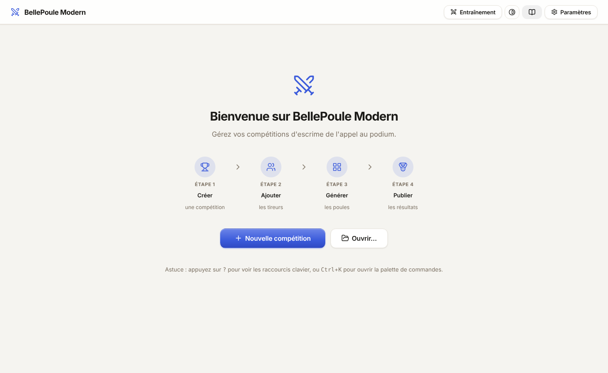

## Nouvelle compétition

Titre, date, arme, genre, catégorie, lieu ; case **Compétition par équipes**.

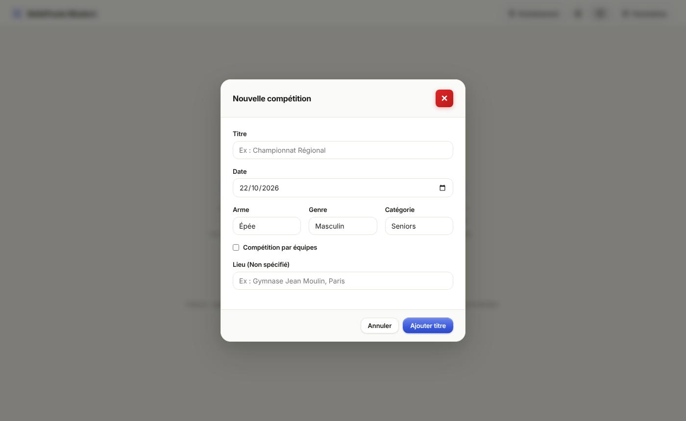

## Liste des compétitions

Onglet **Général** : une carte par compétition (arme, catégorie, lieu, nombre de tireurs), export `.bpm`.

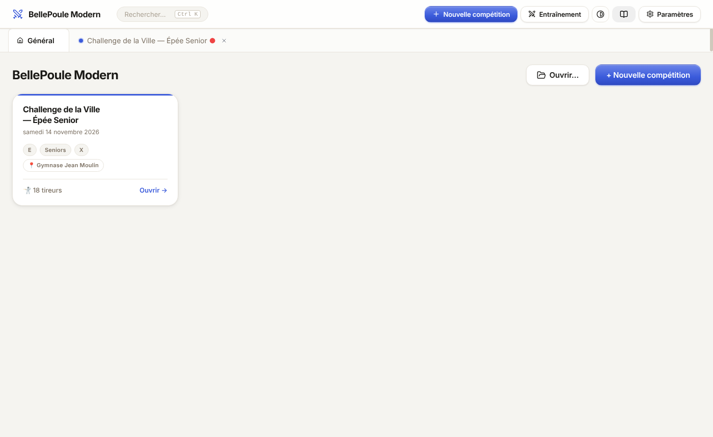

## Appel (pointage)

Phase **Appel** : liste des tireurs, pointage individuel ou **Tout pointer**, import / export, colonnes configurables.

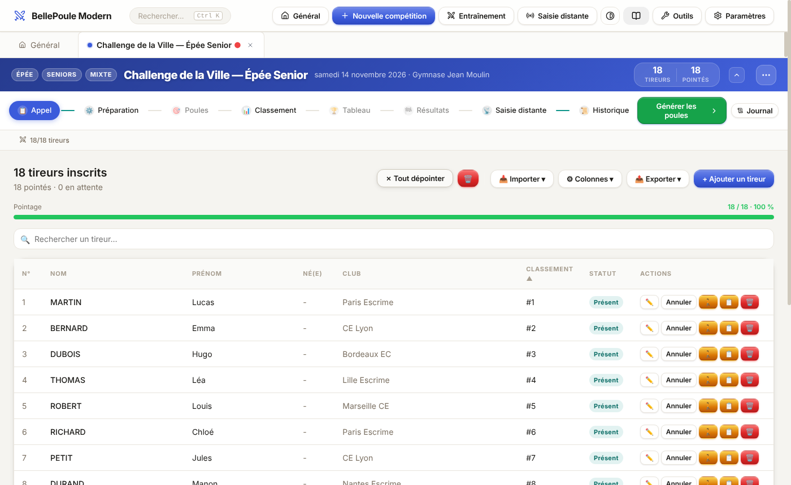

## Préparation des poules

Phase **Préparation** : nombre de poules, taille, critères de séparation (club, région, nation), glisser-déposer entre poules.

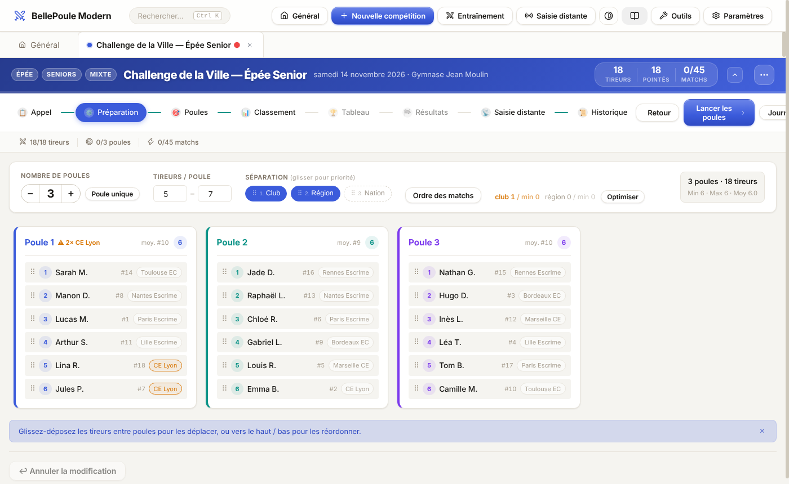

## Poules

Phase **Poules** : feuilles de poule avec saisie des scores, impression, export PDF, arbitres.

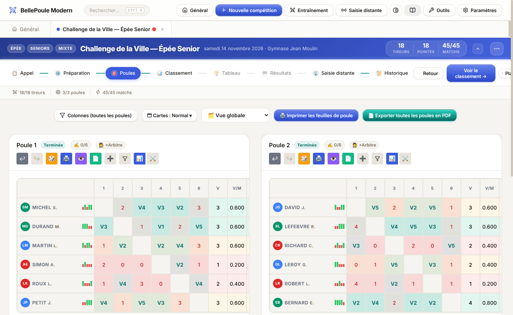

## Classement après poules

Phase **Classement** : V, M, V/M, TD, TR, indice ; export CSV / PDF ; **Passer au tableau**.

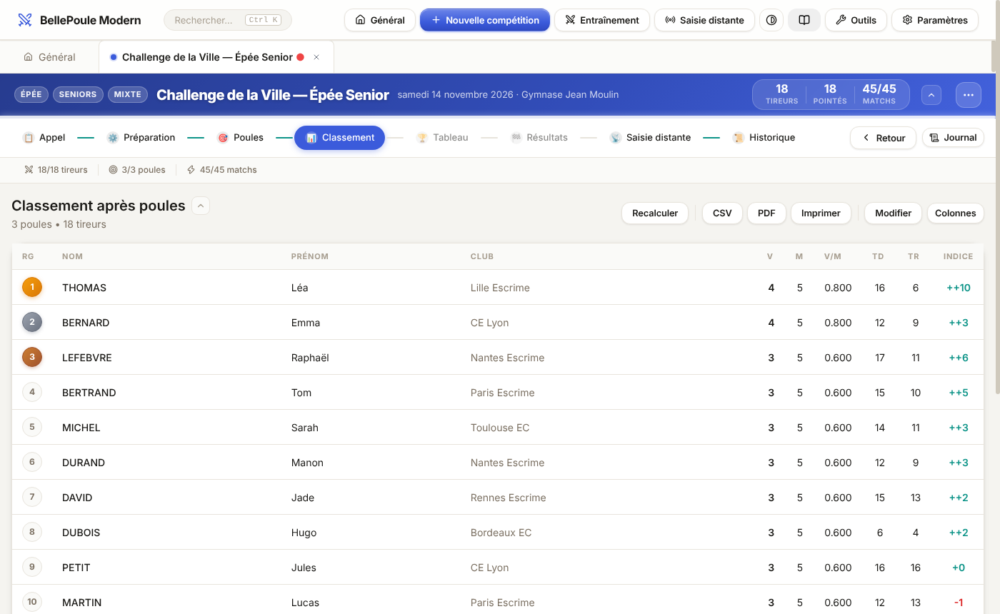

## Tableau

Phase **Tableau** : élimination directe, petite finale, vues tableau / pyramide, menu **Options**.

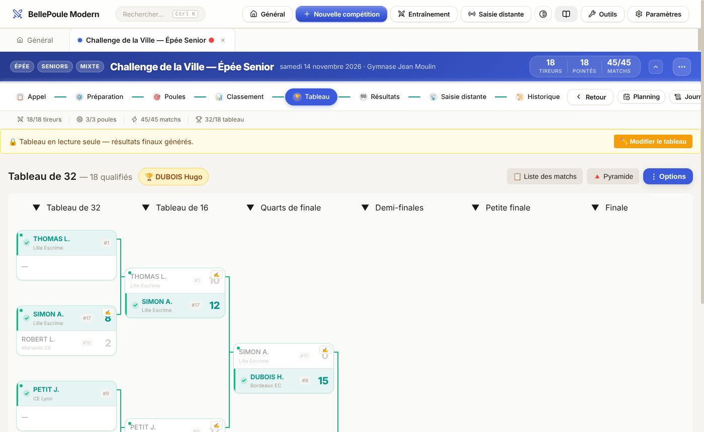

## Résultats

Phase **Résultats** : podium et classement final.

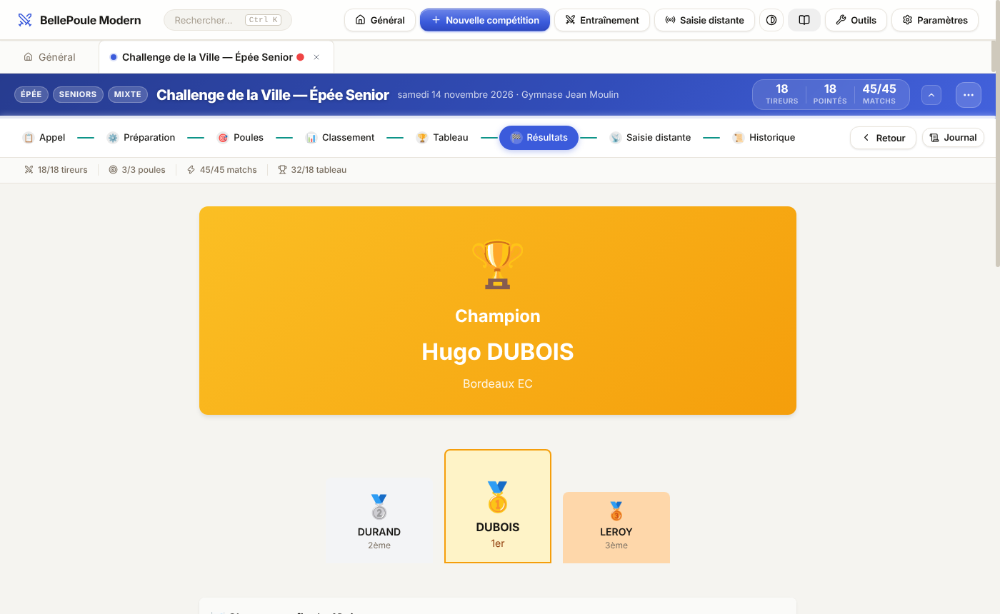

## Saisie distante

Phase **Saisie distante** : pistes, vues kiosque, réseau, HTTPS, démarrage du serveur pour les tablettes. Voir [REMOTE_SCORE_GUIDE.md](../REMOTE_SCORE_GUIDE.md).

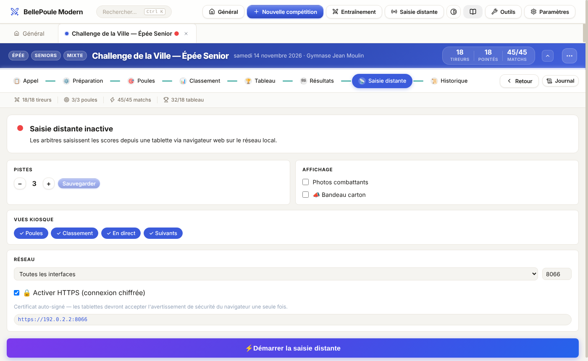

## Historique des scores

Phase **Historique** : journal horodaté de chaque modification de score, filtres, export CSV / JSON.

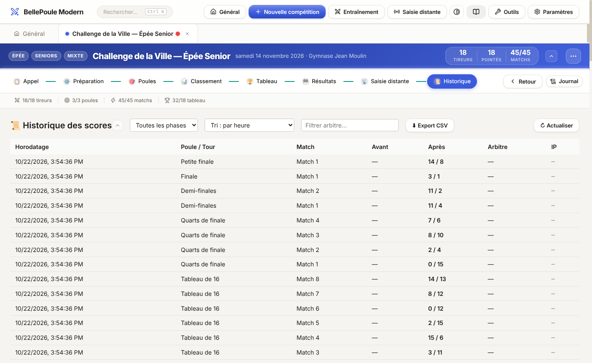

## Menu Actions de la compétition

Bouton **⋯** de l'en-tête : comparaisons, analytics, partage, kiosque public, export, propriétés.

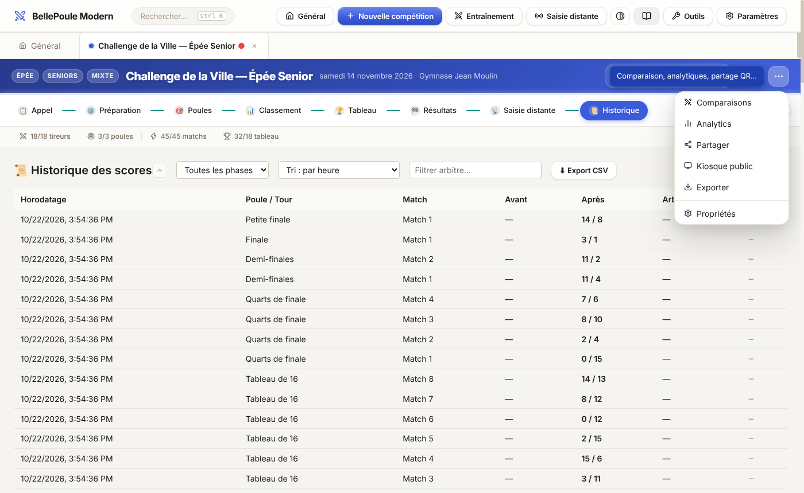

## Menu Outils

Barre supérieure : **QR Code WiFi** ([WIFI_QR_GUIDE.md](WIFI_QR_GUIDE.md)), **Télécommande TV** ([TELECOMMANDE_TV.md](TELECOMMANDE_TV.md)).

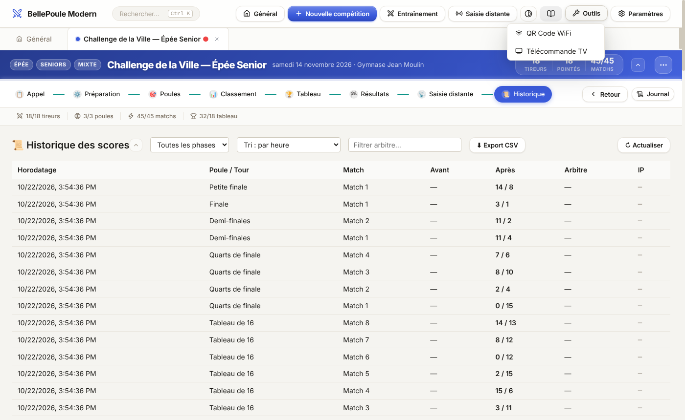

## Paramètres

Langue, thème, taille du texte, logo organisateur, exports PDF, saisie rapide souris…

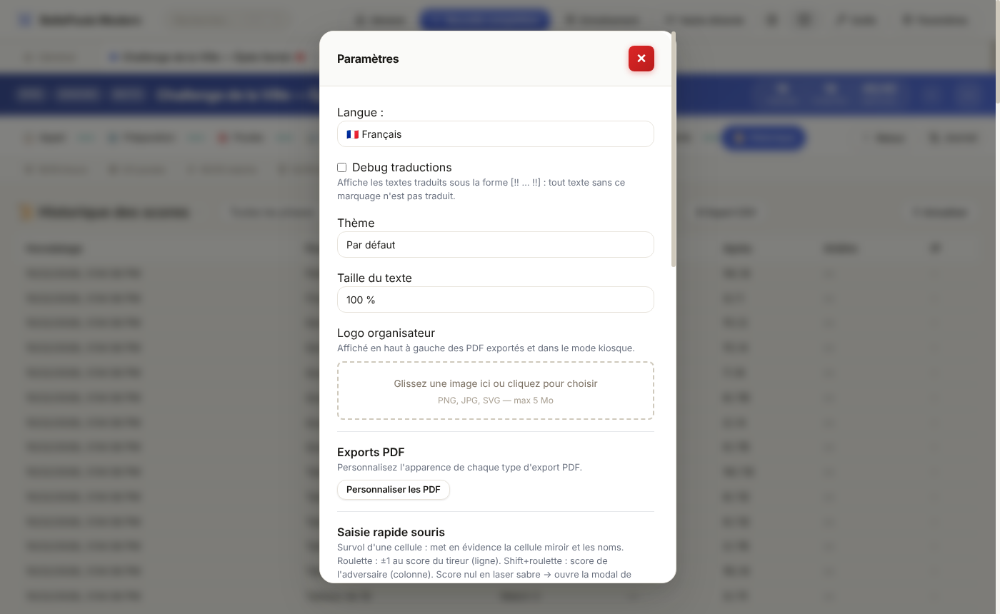

## Mode Entraînement

Arme, nombre de pistes, durée du combat, interface réseau.

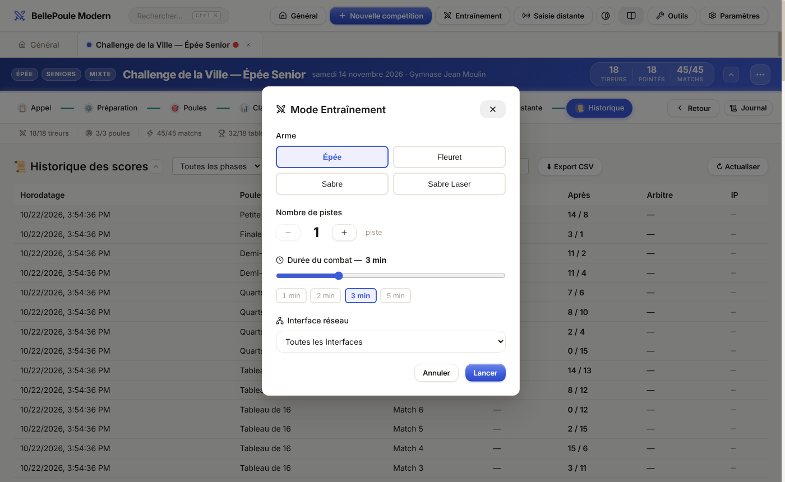

## Palette de commandes

`Ctrl+K` : recherche de compétitions et d'actions.

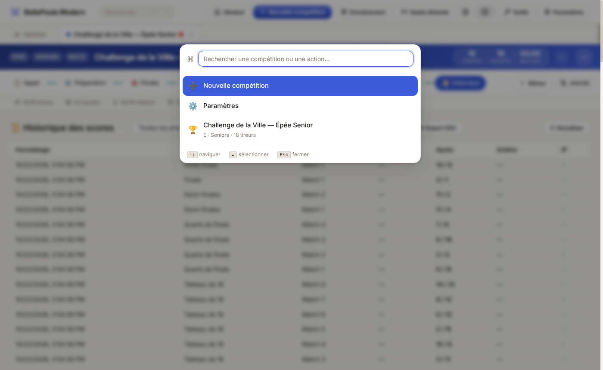
